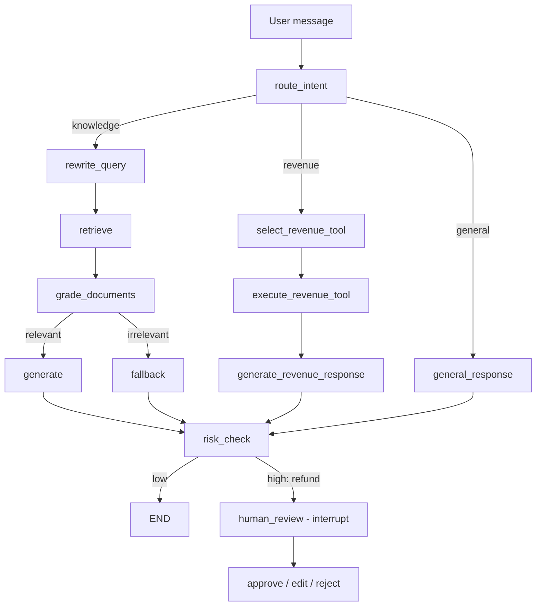

# Enterprise Knowledge RAG Engine

An agentic Retrieval-Augmented Generation chatbot built on **FastAPI**, **LangGraph**, **PostgreSQL** and **ChromaDB**, with a React frontend.

A LangGraph agent routes every message by intent:

- **Knowledge questions** go through a parent/child-chunk RAG pipeline with reranking and relevance grading.
- **Revenue questions** go through role-checked tool calls.
- **High-risk actions** (refunds) pause for human approval before anything executes.

Every request is traced per node and per LLM call. Answer quality is scored for faithfulness, context precision and context recall.

---

## Architecture



- **Intent router**: the LLM fills a typed `RouterDecision` via structured output. Plain conditional edges, not the LLM, decide which node runs next ([router_node.py](backend/app/graphs/router_node.py)).
- **Knowledge RAG** ([rag_graph.py](backend/app/graphs/rag_graph.py), [chroma_manager.py](backend/app/database/chroma_manager.py)):
  - PDFs are split into large **parent chunks**, stored in Postgres, and small **child chunks**, embedded with `all-MiniLM-L6-v2` into a ChromaDB HNSW (cosine) index.
  - At query time, the rewritten query retrieves child candidates, which are reranked with FlashRank and filtered by `RAG_RELEVANCE_THRESHOLD`.
  - The matching parent chunks are loaded from Postgres as context. An LLM grader decides between `generate` and `fallback`.
- **Revenue tools** ([revenue_tools.py](backend/app/services/revenue_tools.py)):
  - The tools are `get_revenue` (role `manager`/`admin`) and `request_refund` (role `admin`).
  - The role check happens inside the tool. `current_user` is injected through `RunnableConfig` and never exposed to the LLM.
  - Data access goes only through [enterprise_revenue_api.py](backend/app/services/enterprise_revenue_api.py).
- **Human-in-the-loop**: refunds trigger a LangGraph `interrupt()`. Graph state is checkpointed in Postgres (`AsyncPostgresSaver`), and the client resumes with `POST /chat/message/resume`.

See [docs/AGENTIC_ARCHITECTURE.md](docs/AGENTIC_ARCHITECTURE.md) for the full request lifecycle and the authorization boundary.

---

## Tech stack

| Layer | Technology |
|---|---|
| API | FastAPI (Python 3.11), managed with `uv` |
| Agent orchestration | LangGraph + LangChain (`langchain-groq`), Postgres checkpointer |
| LLM | Groq, default `openai/gpt-oss-20b` (configurable via `LLM_MODEL`) |
| Relational DB | PostgreSQL 16, SQLAlchemy 2.0 async (`asyncpg`), Alembic migrations |
| Vector DB | ChromaDB 0.5 (HNSW, cosine) + FlashRank reranker |
| Document parsing | `pdfplumber`, Tesseract OCR fallback |
| Auth | JWT, bcrypt password hashing, role-based tool access (`employee` / `manager` / `admin`) |
| Observability | JSONL request traces, optional LangSmith |
| Frontend | React 18, TypeScript, Vite, Tailwind, TanStack Query |

---

## Project layout

```
backend/
  app/
    graphs/         LangGraph nodes: router, RAG, revenue tools, risk/HITL
    rag/graph.py    Graph wiring + compiled agent
    routes/         auth, chat, knowledge, observability
    services/       parsing, chunking, LLM client, revenue tools/API
    database/       Postgres session, Chroma manager, checkpointer
    models/         SQLAlchemy models
    observability/  node/LLM tracing, trace summary
    evaluation/     offline + online answer-quality evaluation
  alembic/          migrations
frontend/           React app
docs/               architecture, evaluation, known limitations
test_queries.csv    labelled evaluation questions
```

---

## Getting started

### 1. Configure the environment

Create `.env.local` in the repo root. Both Docker Compose and the backend read it.

```env
GROQ_API_KEY=...
JWT_SECRET=...
JWT_ALGORITHM=HS256

POSTGRES_USER=postgres
POSTGRES_PASSWORD=...
POSTGRES_DB=rag_enterprise
POSTGRES_HOST=localhost
POSTGRES_PORT=5435

CHROMA_SERVER_HOST=localhost
CHROMA_SERVER_HTTP_PORT=8010

# Optional
LLM_MODEL=openai/gpt-oss-20b
EVAL_JUDGE_MODEL=openai/gpt-oss-20b
RAG_RELEVANCE_THRESHOLD=0.45
EVAL_ONLINE_SAMPLE_RATE=0.0

# Optional: LangSmith tracing
LANGCHAIN_TRACING_V2=false
LANGCHAIN_API_KEY=...
LANGCHAIN_PROJECT=...
```

Groq retires models from time to time. Check `https://api.groq.com/openai/v1/models` if you get a `model_not_found` error.

### 2. Start Postgres and ChromaDB

```bash
docker compose up -d postgres_db chroma_vector_db
```

Postgres is exposed on `localhost:5435` and ChromaDB on `localhost:8010`.

### 3. Run the backend

```bash
cd backend
uv sync
set -a && . ../.env.local && set +a   # alembic does not load .env.local itself
uv run alembic upgrade head
uv run uvicorn app.main:app --reload --port 8000
```

Run `alembic upgrade head` again after pulling new migrations. Otherwise you'll see errors like `column users.role does not exist`.

New users get the `employee` role. To test the revenue tools or the observability endpoints, promote a user directly in Postgres:

```sql
UPDATE users SET role = 'admin' WHERE email = 'you@example.com';
```

### 4. Run the frontend

```bash
cd frontend
npm install
npm run dev
```

The frontend expects the API at `http://localhost:8000` (see [apiClient.ts](frontend/src/services/apiClient.ts)).

---

## API

| Method | Path | Description |
|---|---|---|
| `POST` | `/auth/register` | Create an account |
| `POST` | `/auth/login` | Get a JWT |
| `GET` | `/auth/me` | Current user |
| `POST` | `/knowledge/upload` | Upload and ingest a PDF |
| `POST` | `/chat/message` | Send a message to the agent (may return `requires_hitl: true`) |
| `POST` | `/chat/message/resume` | Approve / edit / reject a paused action |
| `GET` | `/chat/sessions` | List the user's chat sessions |
| `GET` | `/chat/{session_id}/messages` | Messages in a session |
| `GET` | `/observability/summary` | Latency, token, routing and eval aggregates (admin) |
| `GET` | `/observability/traces/{trace_id}` | All events for one request (admin) |
| `GET` | `/health` | Health check |

Interactive docs are served at `http://localhost:8000/docs`.

---

## Observability & evaluation

- Every request writes events, keyed by `trace_id`, to `backend/logs/rag_trace.jsonl`. These cover node latency, LLM token usage, retrieval candidates and grader decisions. The file is git-ignored.
- To summarise traces locally, run `uv run python -m app.observability.summary --last 200`.
- To run offline evaluation (faithfulness, context precision and context recall) on `test_queries.csv`, run `uv run python -m app.evaluation.run`. Add `--limit 3` for a smoke test.
- Set `EVAL_ONLINE_SAMPLE_RATE` above 0 to score a sample of live answers in the background.

Details are in [docs/EVALUATION_AND_OBSERVABILITY.md](docs/EVALUATION_AND_OBSERVABILITY.md).

---

## Known limitations

- Document ingestion runs synchronously inside the upload request.
- There is no persisted document list.
- Only PDF uploads are accepted.
- The `backend` and `frontend` services in `docker-compose.yml` are not runnable yet. The backend `Dockerfile` expects a `requirements.txt` (the project uses `uv`), and the frontend has no `Dockerfile`. Run the app locally as described above.

See [docs/known-limitations.md](docs/known-limitations.md).
