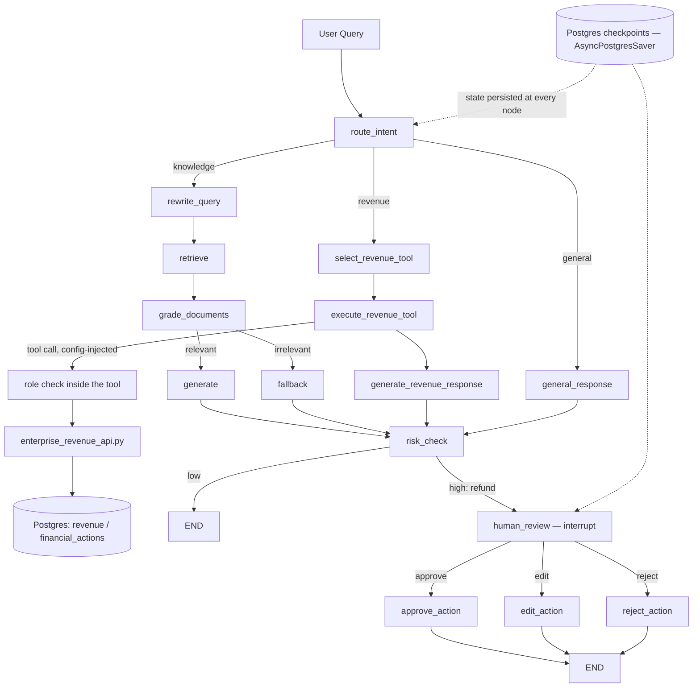

# Agentic Enterprise RAG — Architecture

This extends the existing LangGraph RAG pipeline (`rewrite_query → retrieve →
grade_documents → generate/fallback`) with a top-level intent router, a
revenue tool-calling path, and a human-in-the-loop (HITL) gate for
high-risk actions. The knowledge RAG path itself is unchanged — it just no
longer runs unconditionally; it now only runs when the router says so.

## 1. Architecture diagram



## 2. Request lifecycle

1. `POST /chat/message` — resolves/creates the `ChatSession` row, appends the
   user's message, builds a `RunnableConfig` (`thread_id`, `db_session`,
   `current_user`, `logger`), and calls `app.ainvoke(input_state, config)`
   on the compiled graph (`app/rag/graph.py::get_agent_app`).
2. The graph runs `route_intent` first, then whichever branch the router
   chose, then converges on `risk_check`.
3. If `risk_check` says "low", the graph reaches `END` in the same call —
   the route builds an `AgentMessageResponse`, persists the assistant
   message, and returns.
4. If `risk_check` says "high", `human_review` calls `interrupt(...)` —
   the graph pauses mid-run. `ainvoke` returns with the state as of that
   point; `state_snapshot.next` is non-empty, so the route sets
   `requires_hitl: true` and returns the pending-approval payload instead
   of a final answer.
5. The client calls `POST /chat/message/resume` with the same `thread_id`
   and a decision (`approve`/`edit`/`reject`). The route calls
   `app.ainvoke(Command(resume={...}), config)` — LangGraph resumes
   execution exactly at `human_review`, using the checkpointed state from
   step 4. No new persistence mechanism; same `AsyncPostgresSaver`.

## 3. Router responsibility

`app/graphs/router_node.py::route_intent_node` asks the LLM to fill in a
typed `RouterDecision` (`intent`, `requires_tool`) via
`llm.with_structured_output(...)` — not free text. **The LLM never executes
anything.** `route_after_intent` is a plain Python function reading
`state["intent"]`; LangGraph's conditional edges are the only thing that
decide which node runs next. This is the single most important line to be
able to defend: *the LLM proposes, the graph structure disposes.*

## 4. RAG responsibility

Unchanged. `rewrite_query_node → retrieve_node → grade_documents_node →
(generate_node | fallback_node)`, all in `app/graphs/rag_graph.py`, wired
exactly as before — now entered via the router's `"knowledge"` branch
instead of being the graph's unconditional entry point.

## 5. Tool-calling responsibility

Two `@tool`-decorated functions in `app/services/revenue_tools.py`:
`get_revenue_tool` (read) and `request_refund_tool` (prepares a write for
approval — never executes immediately). Tool *selection and argument
extraction* is its own structured-output step
(`select_revenue_tool_node`, `RevenueToolSelection` model) — arguments are
validated (parseable dates, `end >= start`, positive refund amount) before
`execute_revenue_tool_node` ever calls a tool. The LLM never constructs
SQL and never talks to the database — it fills in a validated schema, and
code executes the corresponding tool.

## 6. Authentication / authorization boundary

```
LLM (proposes tool + args, via structured output)
  → select_revenue_tool_node (validates the args — types, ranges)
  → execute_revenue_tool_node (calls the tool)
      → tool (checks current_user.role — the actual boundary)
          → enterprise_revenue_api.py (queries Postgres)
```

`current_user` and `db_session` reach the tool through `RunnableConfig`
(`config["configurable"]`), which LangChain injects into a `config:
RunnableConfig` tool parameter automatically — **it is never part of the
tool's declared argument schema**, so the LLM cannot see it, set it, or
influence it. `get_revenue_tool` requires role `manager`/`admin`;
`request_refund_tool` requires `admin`. An unauthorized call returns a
structured `{"authorized": false, "reason": ...}` — a refusal built from
code, not from asking the model to "please deny this."

**Why the LLM never touches the database directly**: every DB access goes
through `app/services/enterprise_revenue_api.py`, itself only reachable
through an authorization-checked tool. Even a maximally "jailbroken" LLM
response can only ever produce *arguments* to a fixed, typed tool
interface — it has no path to raw SQL, no path to skip the role check, and
no path to call anything not explicitly wired into the graph.

`enterprise_revenue_api.py` is deliberately named/commented as a stand-in
for a real Django service: in production this module would make an
authenticated HTTP call out to that service; here it's an in-process async
query against the same Postgres instance so the whole thing runs without
standing up a second service, while preserving the same boundary shape.

## 7. HITL lifecycle

- `risk_check_node` (`app/graphs/risk_hitl_nodes.py`) is a plain rule, not
  an LLM call: `tool_name == "request_refund"` ⇒ `risk_level = "high"`,
  everything else ⇒ `"low"`. Fast, deterministic, easy to extend (amount
  thresholds, anomaly scoring, per-user profiles) without touching the
  graph shape.
- High risk ⇒ `human_review_node` calls `interrupt(payload)`. The payload
  includes the risk reason, the AI's proposed response, and the tool
  result (e.g. the pending refund's amount/customer/reason) — everything a
  reviewer needs to decide.
- Resuming with `action: "approve"` marks the underlying `FinancialAction`
  row `executed` (simulated — a status flip, never real money movement) and
  keeps the AI's original response.
- `action: "reject"` marks the row `rejected` and returns a rejection
  message; nothing executes.
- `action: "edit"` approves the underlying action but replaces the
  *outgoing response text* with the reviewer's own wording — it does not
  let a reviewer change the transaction amount itself (that would need a
  full re-validation pass against the same checks `select_revenue_tool_node`
  already ran; deliberately out of scope here).
- A node containing `interrupt()` re-runs from the top on resume — this is
  why `human_review_node` has no side effects before its `interrupt()`
  call; the `hitl_pending` log line lives in `risk_check_node` instead
  (runs once), and all write/audit side effects live in the
  `approve_action`/`edit_action`/`reject_action` nodes that only run once,
  after the decision is known.

## 8. PostgreSQL checkpointing

Reused as-is — `app/database/checkpointer.py`'s `checkpointer_manager`
(`AsyncPostgresSaver` over a `psycopg` pool), initialized once in
`main.py`'s FastAPI `lifespan`. `session_id` doubles as the LangGraph
`thread_id` (already the case before this feature). Every node's output is
a checkpoint row; `interrupt()` doesn't need any special compile-time flag
because a checkpointer is already configured. This means:
- Conversation state (including a paused HITL run) survives an application
  restart — resuming a thread after a redeploy replays from the last
  checkpoint, not from scratch.
- `POST /message/resume` works from a different process/instance than the
  one that hit the interrupt, as long as it has the same `thread_id` and
  the same Postgres — no in-memory state is required.

## 9. Failure/recovery behavior

- **Invalid tool arguments** (unparseable dates, missing refund amount):
  caught in `select_revenue_tool_node` before any tool executes;
  `execute_revenue_tool_node` short-circuits, and the response generator
  turns the validation error into a clarifying question — never a crash,
  never a guessed value.
- **Unauthorized access**: the tool itself returns a structured denial;
  the response generator is instructed to explain the denial and reveal no
  figures.
- **Interrupted run**: persisted via the checkpointer; can be resumed at
  any later time, from any process, with the original `thread_id`.
- **Everything else** (LLM/API errors) currently propagates as a 500 from
  FastAPI — no bespoke retry logic was added, to keep the demo surface
  small; this would be the natural next hardening step.

## 10. Example queries and the path they take

| Query | Path |
|---|---|
| "Who is Mushary?" | `route_intent → knowledge → rewrite_query → retrieve → grade_documents → generate → risk_check(low) → END` |
| "What is our employee code of conduct?" | same knowledge path |
| "Hello" | `route_intent → general → general_response → risk_check(low) → END` |
| "What was revenue last month?" (role=`employee`) | `route_intent → revenue → select_revenue_tool → execute_revenue_tool` — tool returns `authorized: false` → `generate_revenue_response` (explains denial, no figures) → `risk_check(low)` → `END` |
| "What was revenue last month?" (role=`manager`/`admin`) | same path, tool returns real numbers from `revenue` table → `generate_revenue_response` → `END` |
| "Which branch generated the most revenue?" / "Compare revenue between two branches" | same `get_revenue` path, LLM compares `by_branch` figures already computed by `enterprise_revenue_api.fetch_revenue` |
| "Refund LKR 500,000 to customer X" (role=`admin`) | `route_intent → revenue → select_revenue_tool → execute_revenue_tool` (creates `pending` `FinancialAction`) → `generate_revenue_response` → `risk_check(high)` → `human_review` (**pauses**) → `POST /message/resume` with `approve`/`edit`/`reject` → `END` |
| "Refund LKR 500,000 to customer X" (role=`employee`/`manager`) | tool returns `authorized: false` before any `FinancialAction` row is created — never reaches the risk gate as "high" |

**To demo the authorized vs. denied revenue path**, since no admin UI
exists (out of scope for this feature): promote a user manually —
```sql
UPDATE users SET role = 'manager' WHERE email = 'you@example.com';
-- or 'admin' to also unlock request_refund
```
