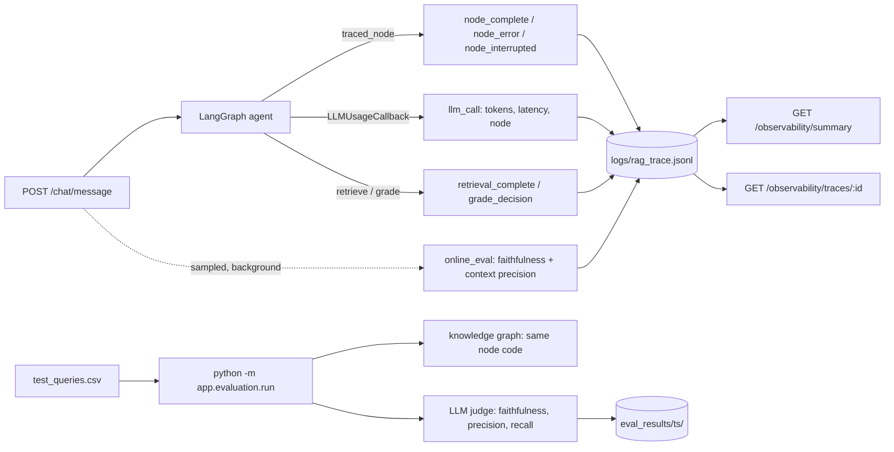

# Evaluation & Observability

This covers two questions about the RAG system:

1. **Observability: what happened on this request?** Every request produces
   a trace with each graph node's latency, each LLM call's token usage, what
   retrieval returned and why, and what the grader decided.
2. **Evaluation: how good are the answers?** The system is scored on
   **faithfulness**, **context precision** and **context recall**. It runs
   offline against a labelled question set and, optionally, on a sample of
   live traffic.

Both write to the same place: JSONL trace events keyed by `trace_id`.



---

## Part 1: Observability

### 1.1 What gets logged

All events go through the existing `RequestLogger` (`app/logging_utils.py`),
so every event from one request shares a `trace_id`. They're written to
stdout and to `backend/logs/rag_trace.jsonl`.

| Event | Emitted by | Key fields | Answers |
|---|---|---|---|
| `query_received` | `routes/chat.py` | `query` | What was asked? |
| `router_decision` | `router_node.py` | `intent`, `requires_tool` | Which path was taken? |
| `node_complete` | `traced_node` (every node) | `node`, `latency_ms` | Where did the time go? |
| `node_error` | `traced_node` | `node`, `error_type`, `error` | Which node failed? |
| `node_interrupted` | `traced_node` | `node` | Paused for human review (not a failure) |
| `llm_call` | `LLMUsageCallback` | `node`, `model`, `prompt_tokens`, `completion_tokens`, `total_tokens`, `latency_ms` | What did this cost? Which prompt is slow? |
| `llm_error` | `LLMUsageCallback` | `node`, `error` | Rate limits and provider failures |
| `retrieval_complete` | `retrieve_node` | `search_query`, `contexts_returned`, `top_rerank_score`, `candidates[]` | What did retrieval find, and what was dropped? |
| `grade_decision` | `grade_documents_node` | `relevant`, `reason` | Why did it fall back? |
| `request_complete` | `routes/chat.py` | `intent`, `requires_hitl`, `response_length`; `elapsed_ms` = end-to-end latency | How long did the user wait? |
| `online_eval` | `evaluation/online.py` | `faithfulness`, `context_precision`, `unsupported_claims` | Was this live answer grounded? |

Each entry in `candidates` covers one child chunk the vector search returned:

```json
{"child_id": "…", "parent_id": "…", "vector_distance": 0.31, "rerank_score": 0.62, "kept": true}
```

`kept: false` means the chunk was dropped, either because it ranked below
`top_k` or because its score fell under `RAG_RELEVANCE_THRESHOLD`. With this
you can tell "the right chunk was never found" (not in candidates) apart
from "it was found but thresholded out" (present, `kept: false`). The two
problems need different fixes.

### 1.2 How it's wired (no changes to node bodies)

- **Node spans.** `app/rag/graph.py` registers every node through
  `_add_node`, which wraps it in `traced_node` (`app/observability/tracing.py`).
  The wrapper times the node and logs the outcome. It handles sync and async
  nodes, with or without a `config` parameter. LangGraph's `interrupt()`
  raises a `GraphBubbleUp` exception, which the wrapper logs as
  `node_interrupted` and re-raises, so HITL pauses aren't counted as errors.
- **LLM calls.** `_build_config` in `routes/chat.py` passes
  `callbacks=[LLMUsageCallback(logger)]`. LangGraph propagates callbacks to
  every `llm.ainvoke(...)` inside the nodes. It also tags each call with
  `metadata["langgraph_node"]`, which is how `llm_call` events know which
  node made them.
- **Correlation.** `config["metadata"]` carries `trace_id` and `user_id`.

### 1.3 Reading it

**Aggregate view** (admin only, because traces contain users' raw queries):

```
GET /observability/summary?last=500
```

This returns p50/p95/max latency end-to-end, per node and per LLM call;
token totals, tokens per request and tokens by node; the router's intent
mix; empty-retrieval rate; fallback rate; average top rerank score; online
eval averages, with the `trace_id`s of answers that scored below 0.7
faithfulness; HITL counts; and error counts.

**One request, every event:**

```
GET /observability/traces/{trace_id}
```

**Without the API** (local dev):

```bash
cd backend
uv run python -m app.observability.summary --last 200
grep '"event": "llm_call"' logs/rag_trace.jsonl | tail
```

### 1.4 Optional: LangSmith

LangGraph already emits LangSmith traces. To turn them on, add these to
`.env.local`; no code change is needed:

```
LANGSMITH_TRACING=true
LANGSMITH_API_KEY=lsv2_...
LANGSMITH_PROJECT=ai-rag-chatbot
```

Every run is tagged with the same `trace_id` as the JSONL log, so you can
move between the two. The JSONL log remains the source of truth because it
works offline, costs nothing, and is what the summary endpoint reads.

---

## Part 2: Evaluation metrics

### 2.1 The three metrics, and what each one isolates

A RAG answer can go wrong at two stages: **retrieval** fetches the wrong
material, or **generation** misuses what it got. Each metric targets one
failure:

| Metric | Stage | Question | Needs reference answer? |
|---|---|---|---|
| **Context precision** | Retrieval | Is what we retrieved relevant, and is the relevant material ranked first? | No (a reference helps) |
| **Context recall** | Retrieval | Did we retrieve *everything* a correct answer needs? | **Yes** |
| **Faithfulness** | Generation | Is every claim in the answer supported by the retrieved context? | No |

Read them together:

| Faithfulness | Recall | Diagnosis | Where to fix |
|---|---|---|---|
| high | high | Healthy | — |
| high | **low** | Answer is grounded but incomplete, or the bot correctly refused. Retrieval missed chunks. | chunking, `n_results`, `top_k`, threshold, query rewrite |
| **low** | high | The right facts were in context but the model added or changed things. **This is hallucination.** | generation prompt, temperature, model |
| **low** | **low** | The model filled the gaps retrieval left with invented facts | both, starting with retrieval |

Low **precision** with high recall means the answer is in there but buried
in noise. That wastes tokens and makes hallucination more likely. Tighten
the reranker threshold or reduce `n_results`.

### 2.2 Faithfulness

```
faithfulness = supported_claims / total_claims
```

1. **Extract.** The judge splits the answer into atomic, self-contained
   claims. "It costs LKR 200,000 and includes dark mode" becomes two claims.
   Greetings, "I couldn't find that", and questions back to the user are
   excluded.
2. **Verify.** Each claim is checked against the retrieved context. It counts
   as supported only if the context states it or directly entails it.
   Numbers, currencies, dates and names must match exactly. A claim that is
   true in the real world but absent from the context is **not** supported.

These are two separate judge calls on purpose. When one prompt both
decomposes and verifies, the model tends to leave out the claims it can't
verify, which inflates the score.

**Not applicable (`None`)** when the answer makes no factual claims, or when
the grader routed to `fallback`. The fallback node never sees context, so
checking it against context isn't meaningful. `None` is excluded from
averages. It is not the same as 0.

**Worked example.** Context: *"Implementation: LKR 200,000. Monthly: LKR 8,500."*
Answer: *"Implementation is LKR 200,000, monthly is LKR 8,500, and there is a 12-month minimum term."*
Claims: 3. Supported: 2 (the minimum term isn't in the context).
**Faithfulness = 0.67**, and the unsupported claim is named in the output.

### 2.3 Context precision (rank-aware)

```
context_precision = Σ_k ( precision@k × rel_k ) / (number of relevant chunks)
```

`rel_k` is 1 if the chunk at rank *k* is relevant and 0 if not.
`precision@k` is the fraction of the top *k* chunks that are relevant.
This is **average precision**. It rewards putting the useful chunk *first*,
not just retrieving it somewhere. Example: with relevance `[no, yes, yes]`,
the score is (1/2 + 2/3) / 2 = **0.58**. With `[yes, yes, no]` it's **1.0**.
Both lists contain the same chunks, but the order is different.

The judge sees each numbered chunk and decides whether it contains
information *needed* to answer. A chunk on the right topic that lacks the
specific fact counts as irrelevant. Offline, the reference answer is
included so "needed" is judged precisely. Online there is no reference, so
the judge uses the question alone.

**This system's retrieval returns 1 parent chunk** (`top_k = 1` in
`retrieve_parent_chunks`). At k = 1, precision is either 0 or 1: "was the
single chunk we used the right one?" It becomes more informative if you
raise `top_k`.

### 2.4 Context recall

```
context_recall = reference_statements_found_in_context / total_reference_statements
```

The judge splits the **reference** answer (`expected_answer_summary` in the
dataset) into statements and checks whether each one can be found in the
retrieved context. It measures against the reference, not the generated
answer, because the question is "did retrieval give the generator a chance
to succeed?"

This is the metric most sensitive to this system's design. Questions that
need two sections, such as *"What are the total costs?"* (implementation fee
plus monthly fee), will score around 0.5 when only one parent chunk is
returned. That's the correct result: it tells you `top_k = 1` is too small
for multi-section questions.

### 2.5 Why an LLM judge, and why not the chunk IDs in the CSV

`test_queries.csv` has an `expected_chunk_ids` column with values like
`chunk_implementation_cost`. Those are descriptive labels. The real chunk
IDs are random UUIDs generated at ingestion (`text_splitter.py`) and change
every time a document is re-uploaded. Exact-match ID precision and recall
therefore can't be computed against them.

A judge that compares *content* against the reference answer works whatever
the chunking. It still gives valid results after you change `parent_size`
or re-ingest, which is when you most want to measure. The column is kept as
documentation of intent.

The judge follows the RAGAS definitions but is implemented directly in
`app/evaluation/metrics.py` (about 250 lines). It runs on the same Groq model
through structured output (Pydantic schemas), so it adds no dependencies and
needs no OpenAI key. Every score comes with its per-claim or per-chunk
verdicts and a reason, so a low score can be explained.

**Caveats of using an LLM as a judge:**

- The judge and the generator are the same model family, so they may share
  blind spots. For a more independent judge, set `EVAL_JUDGE_MODEL` to a
  different model.
- Scores vary slightly between runs even at temperature 0. Treat
  differences under about 0.05 on 20 questions as noise.
- 20 questions is a smoke test, not a benchmark. One question moves the
  mean by 0.05.
- Spot-check the `*_details` in `results.json` before trusting a trend.

---

## Part 3: Running it

### 3.1 Offline evaluation

Start Postgres and Chroma, and make sure the quotation document has been
uploaded. Then:

```bash
cd backend
uv run python -m app.evaluation.run --limit 3          # smoke test
uv run python -m app.evaluation.run                    # full test_queries.csv
uv run python -m app.evaluation.run --delay 2          # if Groq rate-limits you
uv run python -m app.evaluation.run --dataset other.csv --out eval_results/baseline
```

For each question the runner:

1. Asks the live router what intent it would assign (`routed_intent`
   column). A question routed to `general` in production would never reach
   retrieval, and this column makes that visible.
2. Runs the knowledge path (`build_knowledge_graph()`). It uses the **same
   node functions and wiring** as production, without the router, risk gate
   or checkpointer.
3. Scores faithfulness, context precision and context recall.

Cost: about 4 pipeline LLM calls plus 4 judge calls per question, so about
160 calls for the 20-question set.

Output goes to `backend/eval_results/<timestamp>/`, which is gitignored:

| File | Contents |
|---|---|
| `results.csv` | One row per question: scores, `answered`, `routed_intent`, latency, tokens, answer, reference |
| `results.json` | The same, plus `faithfulness_details`, `context_precision_details` and `context_recall_details` (every judge verdict with its reason) |
| `summary.json` | Means overall, by `query_type` and by `difficulty`, plus answer rate, router knowledge rate, latency and tokens |
| `trace.jsonl` | Full node and LLM trace for the run, kept separate from the production log |

**Dataset format:** a CSV with `query` and `expected_answer_summary`. The
columns `query_type`, `difficulty`, `expected_chunk_ids` and `notes` are
optional, and the first two are used for grouping.

**Suggested workflow for any retrieval or prompt change:** run and save it
as a baseline (`--out eval_results/baseline`), make the change, run again,
and compare the two `summary.json` files. Look at `by_query_type` as well as
the overall numbers, because a chunking change that helps `pricing` can
hurt `terms`.

### 3.2 Online evaluation (live traffic)

Set this in `.env.local`:

```
EVAL_ONLINE_SAMPLE_RATE=0.1   # score 10% of grounded knowledge answers
```

After the response has been sent, a FastAPI `BackgroundTask` scores the
answer for faithfulness and context precision. Users see no added latency.
Only knowledge-path answers that passed the grader are sampled. Results are
logged as `online_eval` events under the request's `trace_id`, and
`/observability/summary` reports the averages and lists the traces with low
faithfulness to investigate. Recall isn't computed online because live
traffic has no reference answer.

The default is `0`. Each sampled turn costs 3 extra judge calls.

### 3.3 Configuration

| Env var | Default | Effect |
|---|---|---|
| `EVAL_JUDGE_MODEL` | `llama-3.3-70b-versatile` | Model used as judge (Groq) |
| `EVAL_ONLINE_SAMPLE_RATE` | `0.0` | Fraction of live knowledge answers scored |
| `RAG_RELEVANCE_THRESHOLD` | `0.45` | Rerank cutoff; its effect shows up in `candidates[].kept` |
| `LANGSMITH_TRACING` / `LANGSMITH_API_KEY` | unset | Optional LangSmith tracing |

---

## Part 4: Files

| File | Role |
|---|---|
| `app/observability/tracing.py` | `traced_node` wrapper and `LLMUsageCallback` |
| `app/observability/summary.py` | Aggregates the JSONL log (API and CLI) |
| `app/routes/observability.py` | `GET /observability/summary`, `GET /observability/traces/{id}` (admin) |
| `app/evaluation/metrics.py` | Faithfulness, context precision and context recall judges |
| `app/evaluation/online.py` | Sampled background scoring of live answers |
| `app/evaluation/run.py` | Offline runner |
| `app/database/chroma_manager.py` | `retrieve_parent_chunks` now returns per-chunk contexts and candidate scores (`query_parent_context` kept as a wrapper) |
| `app/rag/graph.py` | Every node registered through `traced_node`; `build_knowledge_graph()` for eval |

## Known limitations

- **The JSONL log grows without limit.** The summary endpoint re-reads the
  whole file on each request. That's fine at this scale. In production,
  ship the logs to Loki, ELK or CloudWatch, or rotate the file.
- `backend/logs/rag_trace.jsonl` is **tracked in git** and contains user
  queries. Consider `git rm --cached` and adding it to `.gitignore`.
- Online eval uses an in-process background task. If the server restarts
  mid-evaluation, that sample is lost, which is acceptable for sampled
  monitoring.
- Only single-turn questions are evaluated. The query-rewrite step (resolving
  pronouns from history) isn't exercised by the current dataset. Add
  multi-turn cases if that path matters.
